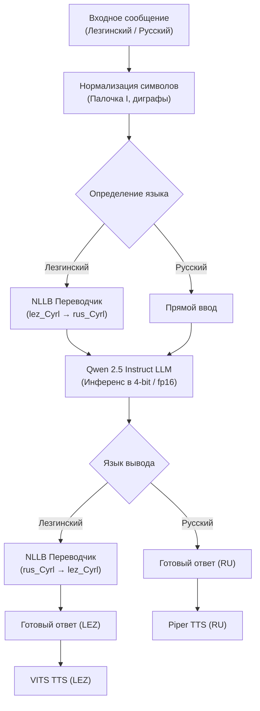

<div align="center">

# 🦅 LEZGi AI (gadz-instruct-lzg)

**Локальная русско-лезгинская языковая модель, нейросетевой переводчик и голосовой ассистент**

[](https://opensource.org/licenses/MIT)
[](https://www.python.org/)
[](https://pytorch.org/)
[](https://huggingface.co/gadz777/gadz-instruct-lzg-models)
[](#системные-требования)

*Полностью автономный программный комплекс для цифровизации, сохранения и практического использования лезгинского языка в современных LLM-системах.*

[Возможности](#-основные-возможности) •
[Архитектура](#-архитектура-системы) •
[Установка](#-быстрый-старт) •
[Модели](#-загрузка-весов-моделей) •
[Запуск](#-способы-запуска) •
[REST API](#-rest-api)

---

</div>

## 📌 О проекте

**LEZGi AI** — это открытый проект, объединяющий современные технологии обработки естественного языка (NLP) и генеративного ИИ для лезгинского языка. 

Система работает **полностью локально** на устройстве пользователя. Все вычисления (перевод, диалог с LLM, синтез речи) происходят на вашем оборудовании без отправки текста на внешние серверы и без зависимости от сторонних платных API.

---

## ✨ Основные возможности

| Компонент | Технология | Описание |
| :--- | :--- | :--- |
| **Диалоговый ассистент** | Qwen 2.5 Instruct (3B / 8B) | Понимание контекста, ответов на вопросы, поддержка диалога на русском и лезгинском языках. |
| **Нейропереводчик** | NLLB-200 (Meta AI) | Высокоточный двусторонний перевод между русским и лезгинским с учетом специфической морфологии. |
| **Нормализация текста** | Regex & Rule-based engine | Автоматическое исправление вариаций лезгинской палочки (`1`, `I`, `l`, `!`, `ӏ` → `Ӏ`) и корректная обработка диграфов. |
| **Синтез речи (Лезгинский)** | VITS Neural TTS | Естественная генерация лезгинской речи (16 kHz). |
| **Синтез речи (Русский)** | Piper ONNX TTS | Быстрая генерация русской речи высокой четкости (`ru_RU-denis-medium`). |
| **Интернет-контекст** | DuckDuckGo / Wikipedia API | Опциональное извлечение актуальных фактов из сети при включенном режиме поиска. |
| **Настольный клиент** | Tauri + React (`gadz.exe`) | Легковесное нативное Windows-приложение с современным интерфейсом. |
| **Веб-интерфейс** | Gradio + FastAPI | Полнофункциональный браузерный интерфейс для чата и перевода. |

---

## 🏛 Архитектура системы

В основе диалогового пайплайна лежит гибридный подход: лезгинский запрос нормализуется, транслируется в общее семантическое пространство и обрабатывается языковой моделью с последующей генерацией ответа и синтезом аудио.



---

## 📂 Структура проекта

Кодовая база разделена на независимые, слабосвязанные модули:

```text
LEZGi/
├── lezgi/                      # Основной пакет библиотеки
│   ├── __init__.py            # Версионирование и экспорт
│   ├── config.py              # Пути к директориям, весам и системные промпты
│   ├── translator.py          # NLLB-модель, эвристика детекции языка и нормализация
│   ├── llm.py                 # Инференс Qwen, кэширование и управление контекстом
│   ├── tts.py                 # Движки синтеза речи (VITS + Piper)
│   ├── search.py              # Модуль веб-поиска для обогащения ответов
│   ├── server.py              # FastAPI REST API + интеграция Gradio UI
│   └── gui.py                 # Настольный GUI на Tkinter
├── translate.py               # Главный CLI-раннер (командная строка, сервер, GUI)
├── app.py                     # Минималистичная точка входа для облачного развертывания
├── desktop-app/               # Исходный код настольного интерфейса (React + Vite + Tauri)
├── requirements.txt           # Зависимости Python
├── run_translator.bat         # Скрипт быстрого запуска сервера
└── run_gadz.vbs               # Автоматический запуск сервера и gadz.exe
```

---

## 🚀 Быстрый старт

### 1. Требования к окружению

* **ОС:** Windows 10/11 или Linux (x86_64)
* **Python:** 3.10 или 3.11
* **CUDA:** Рекомендуется NVIDIA CUDA 12.1+ для ускорения на GPU

### 2. Клонирование и установка

```powershell
# Клонирование репозитория
git clone https://github.com/NetGadz/gadz-instruct-lzg-AI.git
cd gadz-instruct-lzg-AI

# Создание и активация виртуального окружения
py -3.11 -m venv .venv
.venv\Scripts\activate

# Установка зависимостей
pip install -r requirements.txt
```

---

## 📦 Загрузка весов моделей

Все предобученные веса моделей опубликованы в репозитории Hugging Face:
👉 **[huggingface.co/gadz777/gadz-instruct-lzg-models](https://huggingface.co/gadz777/gadz-instruct-lzg-models)**

Скачайте необходимые файлы в корень проекта с помощью `huggingface-hub`:

```powershell
pip install -U huggingface-hub
python -c "from huggingface_hub import snapshot_download; snapshot_download(repo_id='gadz777/gadz-instruct-lzg-models', repo_type='model', local_dir='.', allow_patterns=['models/**', 'lezgi-nllb-600m-200k-syntetics/**'], ignore_patterns=['**/.cache/**', '**/checkpoint/**'])"
```

### Расположение локальных каталогов

| Каталог | Модель | Назначение |
| :--- | :--- | :--- |
| `lezgi-nllb-600m-200k-syntetics/` | NLLB-200 600M | Переводчик между русским и лезгинским |
| `models/gadz-instruct-lzg-4bit/` | Qwen 2.5 3B (NF4) | Основная диалоговая языковая модель |
| `models/vits-lez-tts/` | VITS | Лезгинский синтез речи |
| `models/piper-ru/` | Piper ONNX | Русский синтез речи (`ru_RU-denis-medium`) |
| `models/gadz1-8b/` *(опционально)* | Qwen 2.5 8B | Расширенная модель повышенной точности |

---

## 🎮 Способы запуска

### 1. Веб-интерфейс в браузере (по умолчанию)

```powershell
python translate.py
```
> Запускает сервер на `http://127.0.0.1:8765` и автоматически открывает браузер со вкладками **Чат** и **Переводчик**.

### 2. Запуск нативного приложения Windows (`gadz.exe`)

Дважды кликните по файлу **`run_gadz.vbs`**.  
Скрипт в фоновом режиме запустит локальный бэкенд и откроет десктопное приложение `gadz.exe`.

### 3. Быстрый перевод из командной строки (CLI)

```powershell
# Автоматическое определение языка:
python translate.py "Салам алейкум, стха!"
# Вывод: [lez_Cyrl → rus_Cyrl] Здравствуйте, брат!

python translate.py "Желаю крепкого здоровья и мира вашему дому"
# Вывод: [rus_Cyrl → lez_Cyrl] Къуй квез кӏеви сагъвал ва ислягьвал хьуй кӏвале

# Явное указание языков:
python translate.py --text "Фи хабарар ава?" --src lez_Cyrl --tgt rus_Cyrl
```

### 4. Классический настольный GUI (Tkinter)

```powershell
python translate.py --gui
```

### 5. Режим сервера для внешних приложений / API

```powershell
python translate.py --server --host 127.0.0.1 --port 8765
```

---

## 🔌 REST API

Сервер предоставляет документированный REST API для интеграции с внешними приложениями:

| Метод | Эндпоинт | Тело запроса | Описание |
| :--- | :--- | :--- | :--- |
| `GET` | `/health` | — | Проверка доступности сервиса и статуса CUDA |
| `POST` | `/api/translate` | `{"text": "...", "src": "auto", "tgt": "lez_Cyrl"}` | Прямой машинный перевод |
| `POST` | `/api/chat` | `{"text": "...", "model": "...", "answer_lang": "lez_Cyrl", "online": false, "history": []}` | Диалог с ассистентом |
| `POST` | `/api/speak` | `{"text": "...", "language": "lez_Cyrl"}` | Генерация WAV-аудио с речью |
| `GET` | `/translator` | — | Легковесная страница переводчика |

Интерактивная документация Swagger доступна по адресу `http://127.0.0.1:8765/docs`.

---

## ⚙️ Системные требования

| Режим | Минимальные требования | Рекомендуемые требования |
| :--- | :--- | :--- |
| **GPU (NVIDIA CUDA)** | 6 ГБ VRAM (RTX 2060 / 3050), 8 ГБ RAM | 8+ ГБ VRAM (RTX 3060 / 4060 и выше), 16 ГБ RAM |
| **CPU Only** | 4 ядра CPU, 16 ГБ RAM | 8+ ядер CPU, 32 ГБ RAM (AVX2/AVX-512) |
| **Диск** | ~20 ГБ свободного места на SSD (для весов моделей) | Быстрый NVMe SSD |

---

## 🤝 Вклад в развитие и сообщество

Проект открыт для предложений, улучшений словарей и расширения тренировочных корпусов.  
Если вы нашли неточность в переводе или хотите предложить улучшение:
1. Создайте **Issue** с описанием кейса;
2. Либо отправьте **Pull Request** с правками.

---

## 📄 Лицензия

* Исходный код проекта распространяется под лицензией **[MIT](LICENSE)**.
* Веса базовых моделей распространяются согласно соответствующим лицензиям их создателей (Meta NLLB, Qwen Open Model License, Piper TTS).

---

<div align="center">

**Автор:** [NetGadz](https://github.com/NetGadz) • [gadz03080@gmail.com](mailto:gadz03080@gmail.com)  
*Разработано с заботой о сохранении и развитии языкового наследия.*

</div>
